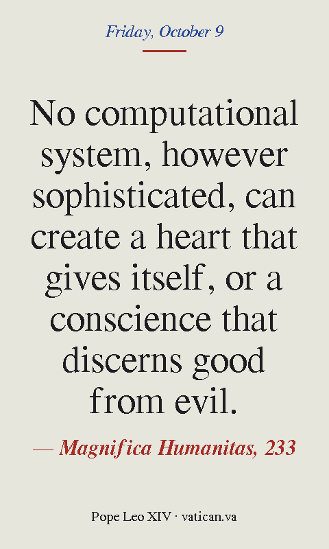

# Quote Frame

A daily quote frame on a 7.3" colour e-paper display. Each night it shows a
new passage from Pope Leo XIV's encyclical *Magnifica Humanitas* (15 May 2026),
on safeguarding the human person in the age of artificial intelligence.

<p align="center"></p>

- **102 passages** from every chapter, one a day, spread across the letter so
  consecutive days come from different chapters
- **Reads the text from vatican.va** each morning. The firmware stores only
  paragraph and sentence numbers, not the encyclical's text
- **Runs on battery for about a month.** It wakes once a day, connects to
  Wi-Fi, draws, and goes back into deep sleep. E-paper keeps the image with no
  power at all
- **Press BOOT** to skip to the next passage
- Battery level in the footer, with a "please charge" warning when it's low

The image above is drawn by the same layout code the frame runs
(`tests/render_preview.cpp`). On the real panel the colours are the panel's
inks rather than pure screen colours.

---

## What you need

| Item | Notes |
|---|---|
| **Waveshare ESP32-S3-PhotoPainter** | [waveshare.com/esp32-s3-photopainter.htm](https://www.waveshare.com/esp32-s3-photopainter.htm). A 7.3" six-colour (Spectra 6) e-paper panel, ESP32-S3, AXP2101 power chip and a wooden frame. **Choose the option with the battery** (1,500 mAh lithium) unless you'll keep it plugged in. Also sold through Amazon and other Waveshare resellers. |
| USB-C data cable | Must carry data, not just charge |
| 2.4 GHz Wi-Fi | The ESP32-S3 doesn't do 5 GHz. Networks with a captive portal (a sign-in web page) won't work |
| A computer with the Arduino IDE | Windows, macOS or Linux |

No soldering or extra parts.

---

## Setup

### 1. Install the Arduino IDE

Download **Arduino IDE 2.x** from [arduino.cc/en/software](https://www.arduino.cc/en/software)
and install it.

### 2. Add ESP32 support

1. **File → Preferences** (on macOS: **Arduino IDE → Settings**).
2. In **Additional boards manager URLs**, add:
   ```
   https://espressif.github.io/arduino-esp32/package_esp32_index.json
   ```
3. **Tools → Board → Boards Manager**, search for **esp32**, and install
   **esp32 by Espressif Systems**. Tested with version **3.3.12**; use a 3.x
   version.

### 3. Install the libraries

**Tools → Manage Libraries**, then search for and install:

| Library | Author | Tested version |
|---|---|---|
| **GxEPD2** | Jean-Marc Zingg | 1.6.9 |
| **Adafruit GFX Library** | Adafruit | 1.12.6 |

If the IDE asks to install dependencies (Adafruit BusIO), choose
**Install all**.

Nothing else is needed. Wi-Fi, HTTPS, I2C and deep sleep all come with the
ESP32 package, and the fonts are included in the sketch.

### 4. Get the code

Download this repository (**Code → Download ZIP** on GitHub, then unzip it)
or clone it:

```
git clone https://github.com/<your-account>/<this-repo>.git
```

Open **`firmware/QuoteFrame/QuoteFrame.ino`** in the Arduino IDE. The other
files in that folder open as tabs alongside it. Keep them together, and keep
the `src/fonts` folder where it is.

### 5. Set the board options

Connect the frame with the USB-C cable, then in the **Tools** menu:

| Setting | Value |
|---|---|
| Board | **ESP32S3 Dev Module** |
| Port | the one that appeared when you plugged in the frame (see below if none did) |
| USB CDC On Boot | **Enabled** (needed to see the Serial Monitor) |
| Flash Size | **16MB (128Mb)** |
| Partition Scheme | default is fine (the sketch uses about 88% of it) |
| PSRAM | not needed; leave as is |

#### If no port appears

The PhotoPainter connects straight to the ESP32-S3's own USB port, so a port
only exists while the chip is awake and running. When it's asleep, switched
off, or running firmware that doesn't use USB, plugging it in shows nothing.
Once the Quote Frame is installed it's asleep almost all the time, so expect
this every time you want to upload again.

The fix is **download mode**, where the chip waits for a new upload and the
port stays put. This is Waveshare's sequence for this board:

1. Plug the frame into the computer with the USB-C cable.
2. **Hold PWR for 5 seconds** to switch the frame off. If it has a battery,
   this matters: unplugging USB alone won't turn it off.
3. **Press and hold BOOT.**
4. While still holding BOOT, **click PWR** once to switch it on.
5. **Release BOOT.** The screen doesn't change; that's expected.
6. In **Tools → Port**, a new port should now be listed. Select it and upload.

What the port is called:

| Computer | Looks like |
|---|---|
| macOS | `/dev/cu.usbmodem…` (ignore `/dev/cu.Bluetooth-Incoming-Port`) |
| Windows | `COM3`, `COM4`… In Device Manager it's under **Ports (COM & LPT)**, often as *USB JTAG/serial debug unit* or *USB Serial Device* |
| Linux | `/dev/ttyACM0` |

Still nothing?

- **Try a different cable.** Many USB-C cables only carry power. The frame
  will charge on one of those, but the computer never sees it. A cable you've
  used to sync a phone or transfer files is a safe bet.
- **Plug straight into the computer**, not through a hub, dock or monitor.
- **Windows:** if Device Manager shows an unknown device with a yellow
  warning sign, install the USB driver linked from Waveshare's
  [PhotoPainter wiki](https://www.waveshare.com/wiki/ESP32-S3-PhotoPainter)
  (FAQ: *Unable to detect the COMx port?*), then unplug and replug.
- **Linux:** if the port appears but upload says *permission denied*, add
  yourself to the serial group (`sudo usermod -aG dialout $USER`, then log
  out and back in).
- **Close the Serial Monitor** and any other program that might hold the
  port (another Arduino IDE window, a terminal program), then try again.

### 6. Configure

Open the **`config.h`** tab. You must set:

```c
#define WIFI_SSID      "your-network"
#define WIFI_PASSWORD  "your-password"
```

Worth checking:

| Setting | Default | What it does |
|---|---|---|
| `TZ_INFO` | US Eastern | Your time zone, as a [POSIX TZ string](https://github.com/nayarsystems/posix_tz_db/blob/master/zones.csv) |
| `UPDATE_HOUR`, `UPDATE_MINUTE` | 0, 15 | When the new quote goes up each night |
| `PANEL_ROTATION` | 1 | Portrait. If the text comes out upside down for how your frame stands, use `3`. `0` or `2` for landscape |

Everything else (colours, alignment, the date line, footer text, battery
display) is optional and explained in the file.

### 7. Upload

Click **Upload** (the → arrow). When it finishes, open **Tools → Serial
Monitor** at **115200** baud. The frame draws its first quote straight away;
the refresh takes about 25 seconds and flickers through colours while it
works, which is normal for this kind of panel. You should see:

```
QuoteFrame, wake: power on
battery 4012 mV, 82%, on USB
wifi ok, 192.168.1.57, rssi -58
quote 17 of 102: paragraph 25, sentence 0
read 134704 bytes in 933 ms
Magnifica Humanitas, 25: Understanding that the truth is a gift ...
rendering
layout: size step 2, 9 lines
refresh took 26xxx ms
sleeping 43200s (timer 43200s)
PMU: asleep, rails off
```

After that it sleeps until the next night's update. Unplug it and stand it
up.

If you uploaded from download mode, the frame normally restarts by itself
when the upload finishes. If the screen doesn't start updating within a
minute, hold **PWR** for 5 seconds to switch it off, then click **PWR** to
switch it back on.

**Watching Serial later:** the port disappears whenever the frame goes back
to sleep. To see a run, open the Serial Monitor, then press **BOOT** on the
frame. It wakes, the port reappears, and the monitor reconnects (if it
doesn't, choose the port again in **Tools → Port**). You'll see that run's
log until it sleeps again about a minute later.

---

## Using it

- **A new passage every night** at the time set in `config.h`.
- **BOOT** wakes it and shows the next passage (about 30–60 seconds: Wi-Fi,
  download, then the refresh). Presses while it's already updating do
  nothing. The following night carries on from there.
- **Charging:** plug in USB-C. The footer shows `· charging 64%` on the next
  update, and turns red with "Battery low — please charge" below 15%. The
  battery percentage takes a full charge or two to settle.
- If Wi-Fi or the website is down, the current quote stays up and it tries
  again after 30 minutes, then 1, 2 and 4 hours.

---

## How it works

Once a night the ESP32 wakes from deep sleep and:

1. switches on Wi-Fi and sets its clock from the internet (NTP)
2. works out today's entry in `quotes.h`
3. downloads the encyclical from vatican.va, reading only until the wanted
   paragraph has gone by, and cuts the chosen sentences out of it
4. picks the largest font size that fits, wraps the lines evenly and draws it
5. puts the power chip and itself back to sleep until the next night

Which passage comes up is tied to the date, so it survives a flat battery or
a re-flash.

### Battery life

Before sleeping, the frame puts the board's AXP2101 power chip into its own
sleep mode and switches off every power rail except the ESP32's (the e-paper
panel, audio, SD card, sensors). On the next wake it pulses the power chip's
IRQ line (GPIO21) low and the chip switches the rails back on by itself.

It has to go through the power chip's sleep mode, not just switch rails off:
the unpowered chips on the shared I2C bus hold it low, and the ESP32 then
can't reach the power chip to turn anything back on.

Waveshare measured about 1.2 mA with the board asleep this way, which works
out to roughly a month on the 1,500 mAh battery. The ESP32's sleep timer
drifts by up to a few percent, so the frame measures that drift each day and
corrects for it.

### The passage list

`quotes.h` has one line per passage, in reading order:

```c
{ 233, 3, 1 },   // no computational system can create a heart
```

That's paragraph 233, starting at sentence 3 (counting from 0), one sentence
long. Some entries are two sentences, where the second completes the first.

Sentences are split at `.` `?` or `!` followed by a capital letter.
Abbreviations like `cf.`, `St.` and `e.g.` and initials like `J.R.R.` don't
count, and footnote markers like `[12]` are removed first.

With `SPREAD_QUOTES` on (the default) the frame doesn't go down the list in
order. It steps through it by a stride of about 3/8 of the list's length, so
consecutive days come from different chapters, and every passage still comes
up exactly once per cycle. Set it to `false` in `config.h` to go in reading
order.

---

## Changing the passages

The `tests/preview_quotes` tool runs the firmware's own parsing code on a
saved copy of the page, so you can see exactly what each entry will show
before uploading. It needs a C++ compiler (`g++` or `clang++`; on macOS,
`xcode-select --install`).

```
cd tests
curl -L -o page.html "https://www.vatican.va/content/leo-xiv/en/encyclicals/documents/20260515-magnifica-humanitas.html"
g++ -std=c++17 -I. -I../firmware/QuoteFrame preview_quotes.cpp -o preview_quotes

./preview_quotes page.html        # every entry in quotes.h, as the frame will show it
./preview_quotes page.html 140    # paragraph 140 split into numbered sentences
```

The second form is how to find new passages: pick the paragraph, read off
the sentence numbers and add a line to `quotes.h`. The tool also flags any
entry too long to fit on the panel.

### Using a different document

The parser works with any page whose paragraphs start with their number
(`<p>12. ...`), which is how the Vatican publishes encyclicals, exhortations
and other letters. Change `QUOTE_PAGE_URL` and `QUOTE_SOURCE` in `config.h`,
then rebuild `quotes.h` with the preview tool.

---

## Troubleshooting

| Symptom or Serial message | What to do |
|---|---|
| No port in **Tools → Port** | The frame is asleep or off. Use download mode; see [If no port appears](#if-no-port-appears) |
| Screen never changes, Serial shows nothing | Check that USB CDC On Boot is **Enabled**, then press **BOOT** to wake it. On battery, click **PWR** in case it's switched off |
| `wifi failed` | Wrong SSID or password, a 5 GHz-only network, or out of range |
| `ntp failed, using sleep clock` | Your network may block internet time servers (common on school and office networks). It keeps going on its own clock, which drifts a little |
| `http 403` / `http 503` | vatican.va refused the request. It retries on its own |
| `no numbered paragraphs on the page` | The page's layout or address changed. Run `preview_quotes` on a fresh copy |
| `paragraph 52 has 7 sentences; wanted 7+1` | An entry in `quotes.h` is past the end of its paragraph. Check it with `preview_quotes page.html 52` |
| `_refresh : 7` (a tiny number) and nothing drawn | The panel had no power. Usually follows `PMU: no response at 0x34`, below |
| `PMU: no response at 0x34` | The power chip is stuck with its rails off. Unplug USB **and** disconnect the battery for 10 seconds. If it happens again, set `POWER_DOWN_IN_SLEEP` to `false` in `config.h` (shorter battery life, but it will work) |
| Text upside down | Set `PANEL_ROTATION` to `3` (or `1` if it was `3`) |
| Faint ghost of the previous quote | Set `CLEAR_BEFORE_DRAW` to `true` |

The HTTPS connection doesn't verify vatican.va's certificate
(`client.setInsecure()`). Only a page request is sent, nothing private, and
the worst a spoofed page could do is show different text.

---

## Files

```
firmware/QuoteFrame/
  QuoteFrame.ino      wake, pick today's passage, fetch, draw, sleep
  config.h            Wi-Fi, time zone, display and battery settings
  quotes.h            the list of passages
  quote_source.h      finds a paragraph in the page as it downloads; splits sentences
  verse_text.h        HTML entities and UTF-8 -> characters the panel fonts can draw
  verse_layout.h      picks the font size, wraps and centres the text
  fonts.h, src/fonts/ FreeSerif in several sizes, with curly quotes and dashes
  pmu.h               AXP2101 power chip: panel power, battery level, sleep
  panel.h             GxEPD2 panel driver with a longer refresh timeout
  board_pins.h        the PhotoPainter's GPIO map
tests/
  preview_quotes.cpp  shows what each entry in quotes.h will display
  test_quotes.cpp     parser, sentence splitter and layout tests
  render_preview.cpp  draws a layout to an image file
docs/
  preview.png
```

### Running the tests

```
cd tests
g++ -std=c++17 -I. -I../firmware/QuoteFrame test_quotes.cpp -o test_quotes && ./test_quotes
```

These feed a made-up page with the same structure as the Vatican's into the
parser in random-sized chunks and a byte at a time. They check paragraph
finding, stopping early, sentence splitting, footnote removal, the date
rotation, that no two entries overlap, and that quote-length text fits the
panel.

---

## Credits and licences

- The text of *Magnifica Humanitas* is © Dicastero per la Comunicazione –
  Libreria Editrice Vaticana. This repository doesn't contain it; the frame
  reads it from [vatican.va](https://www.vatican.va/content/leo-xiv/en/encyclicals/documents/20260515-magnifica-humanitas.html)
  each time, and `quotes.h` holds only paragraph and sentence numbers.
- Fonts: [GNU FreeFont](https://www.gnu.org/software/freefont/) FreeSerif
  (GPLv3 with the font embedding exception), converted with Adafruit GFX's
  `fontconvert`. See `firmware/QuoteFrame/src/fonts/README.md`.
- Display driver: [GxEPD2](https://github.com/ZinggJM/GxEPD2) by Jean-Marc
  Zingg. Graphics: [Adafruit GFX](https://github.com/adafruit/Adafruit-GFX-Library).
- Power-down sequence based on Waveshare's power-consumption test in
  [waveshareteam/ESP32-S3-PhotoPainter](https://github.com/waveshareteam/ESP32-S3-PhotoPainter).
